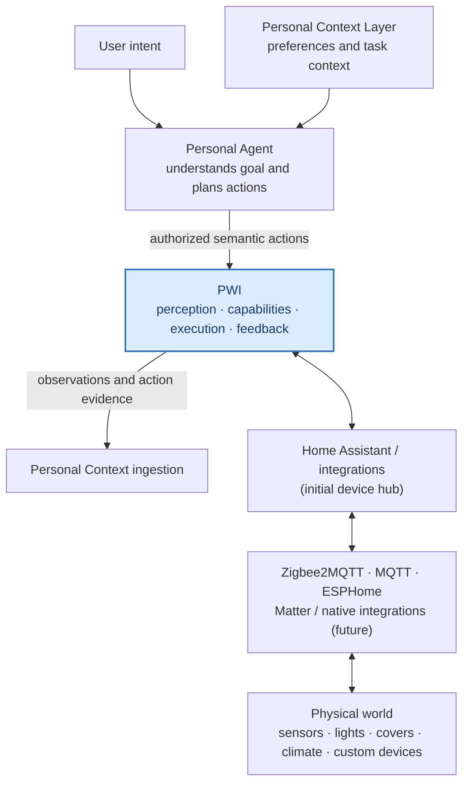
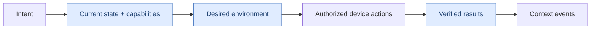

# Physical World Interface (PWI)

### Perceive. Understand. Act. Verify.

**A public, agent-ready reference project for the physical world.**  
PWI is designed to let Personal Agents understand what physical devices can do, observe current environmental state, request authorized actions, and verify what actually happened.

**Home IoT is our first lab, not our final boundary.** The same ideas should extend to wearables, offices, vehicles and custom physical devices.

> [!IMPORTANT]
> **🎯 Building the project? Open [MISSION CONTROL →](START_HERE.md)**  
> **NOW:** [#6 — Install Home Assistant and open its dashboard](https://github.com/cz-33-ai/physical-world-interface/issues/6).  
> **NEXT:** [#7 — Connect MQTT + Zigbee2MQTT](https://github.com/cz-33-ai/physical-world-interface/issues/7) → [#8 — Verify sensor updates](https://github.com/cz-33-ai/physical-world-interface/issues/8).

| **🚀 TRY IT** | **🎬 FLAGSHIP DEMO** | **🗺️ ROADMAP** | **🤝 CONTRIBUTE** |
|:---:|:---:|:---:|:---:|
| [5-minute Quick Start](QUICKSTART.md) | [Prepare for Sleep](docs/demos/prepare-for-sleep.md) | [Milestones & Issues](START_HERE.md) | [Start contributing](CONTRIBUTING.md) |

---

## The one-minute idea

Imagine telling your Personal Agent:

> **"I'm getting ready for bed."**

An Agent should not need to know the Zigbee firmware of your light, the brand of your curtains, or which service controls your speaker. Instead, it should be able to discover a room's current state and **available capabilities**, then request meaningful physical outcomes:

| Perceive | Understand | Act | Verify |
|---|---|---|---|
| Main light is on | Sleep environment should be dark | Turn off light | Read back reported state |
| Curtains are open | Close for bedtime | Close curtains | Confirm reported position |
| AC target is 25 °C | User prefers 22 °C | Set target to 22 °C | Confirm target setting; do not claim room instantly reaches 22 °C |
| Music is playing | Stop playback | Stop speaker | Check player state |

**Crucial distinction:** *sending a command is not the same as confirming a physical outcome.*

The examples above describe the **target product experience**, not an already deployed four-device system.

## Architecture — where PWI fits



**Responsibility boundary:**
- **Personal Agent:** user intent, planning and task-level reasoning.
- **Personal Context Layer:** personal preferences, long-term memory and evolving user facts.
- **PWI:** physical device identity/capabilities, state, authorized operation and execution evidence.
- **Home Assistant and adapters:** first practical infrastructure for managing and accessing actual devices.

Read the [high- and middle-level architecture](docs/architecture/pwi-overview.md). PWI builds on, but does not replace, the approved Personal Agent Platform architecture.

## Try a working example today — no hardware required

This repository includes a **real, runnable Python simulation** of the semantic action lifecycle. It is explicitly **not** an LLM Agent, Home Assistant integration or hardware controller.

Requires Python 3.10+ and no third-party packages:

```bash
git clone https://github.com/cz-33-ai/physical-world-interface.git
cd physical-world-interface

# See the planned device operations (dry run; default)
python3 examples/prepare_for_sleep_simulator.py

# Apply to MOCK devices only and inspect mock state read-back
python3 examples/prepare_for_sleep_simulator.py --apply

# Simulate a disconnected curtain; report partial success
python3 examples/prepare_for_sleep_simulator.py --apply --scenario offline

# Verify the simulator
python3 -m unittest discover -s tests -v
```

➡️ [**Step-by-step Quick Start and limitations**](QUICKSTART.md)

**What is real already?** The existing lab validated local MQTT publish/subscribe, Zigbee2MQTT motion/illuminance telemetry, and ESP32-C3 Wi-Fi/MQTT communication. No Home Assistant deployment or multi-device physical actuation has been verified yet.

## Our flagship reference demo

**Prepare for Sleep** is the first experience we want outside developers to reproduce:



| Step | Target | Status |
|---|---|---|
| Demo 0 | A deterministic offline plan and simulated feedback | **Available** |
| Demo 1 | One actual actuator, Home Assistant and verified state | Planned |
| Demo 2 | Two or more devices coordinated toward one environmental goal | Planned |
| Demo 3 | External Agent + personal preferences + physical-world context handoff | Planned |

See the [**flagship demo storyboard, acceptance criteria and evidence plan**](docs/demos/prepare-for-sleep.md).

## Roadmap

| Stage | Outcome | Status |
|---|---|---|
| **M0 — Local connectivity** | Mosquitto, Zigbee telemetry, ESP32 communication | ✅ Baseline validated |
| **M1 — Unified device hub** | Home Assistant sees existing sensors | 🔵 Active: [#6](https://github.com/cz-33-ai/physical-world-interface/issues/6) |
| **M2 — Physical control** | One actuator with trustworthy feedback | Planned: [#3](https://github.com/cz-33-ai/physical-world-interface/issues/3) |
| **M3 — Agent action** | Prepare for Sleep across connected capabilities | Planned: [#4](https://github.com/cz-33-ai/physical-world-interface/issues/4) |
| **M4 — Context handoff** | Evidence-rich observation/action events for the platform | Planned: [#5](https://github.com/cz-33-ai/physical-world-interface/issues/5) |
| **M5 — Operations** | Security, tests, recovery, portability | Planned |

[**Mission Control: What do I do next? →**](START_HERE.md) · [Detailed roadmap](docs/roadmap.md) · [All issues](https://github.com/cz-33-ai/physical-world-interface/issues)

## Learn by building

We want PWI to become a **developer education project**: a course where a learner gains both the electronics/software skills and the mindset to connect the physical world to Personal Agents.

| Get started | Build hardware | Integrate intelligence |
|---|---|---|
| Networking and MQTT | Zigbee and ESP32 | Device abstraction and Home Assistant |
| [MQTT lab](docs/01-mqtt-broker-and-lan-test.md) | [ESP32 lab](docs/02-esp32c3-esphome-mqtt.md), [Zigbee lab](docs/03-zigbee2mqtt-sensor-observations.md) | Agent tools, state verification and context events (planned) |

[Full course curriculum →](docs/course-plan.md)

## Contribute and follow the build

- **New here?** Run the [offline simulator](QUICKSTART.md), then open an Issue if any step fails.
- **Have IoT expertise?** Help design reliable device state/feedback handling or review [the first integration milestones](START_HERE.md).
- **Have agent experience?** Contribute to capability schemas, authorization boundaries and event outputs.
- **Want to teach?** Improve our [course plan](docs/course-plan.md) and convert verified experiments into reproducible lessons.

[Contribution guide](CONTRIBUTING.md) · [Open issues](https://github.com/cz-33-ai/physical-world-interface/issues?q=is%3Aissue+is%3Aopen) · [Community/release plan](docs/community/launch-plan.md)

## Trust, privacy and project status

This project is an early-stage reference implementation and learning environment, **not a production-ready autonomous controller**. Never publish real Wi-Fi passwords, IP assignments, SSIDs, hardware identifiers, Zigbee keys or raw household logs. Physical actions need scoped permissions and truthful outcome reporting.

Public documentation and code live here; private raw experiments stay in a separate repository. Any mock device, AI step or future architecture is clearly labeled as such.

**Licensing:** a formal open-source license has **not yet been selected** ([decision issue #12](https://github.com/cz-33-ai/physical-world-interface/issues/12)). Public visibility does not, by itself, authorize unrestricted reuse.

**Build real things. Verify outcomes. Teach what works.**
