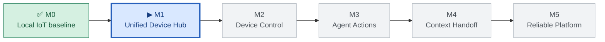

# PWI — Mission Control

> **When you're not sure what to do, open this page.** One active task, a short queue, and links to detailed instructions.  
> Physical World Interface — **Perception · Understanding · Action · Feedback**

**[🏠 Project Home](README.md)** · **[📐 Architecture](docs/architecture/pwi-overview.md)** · **[🧭 Roadmap](docs/roadmap.md)** · **[📋 All Open Issues](https://github.com/cz-33-ai/physical-world-interface/issues?q=is%3Aissue+is%3Aopen)**

---

## 🚪 Two ways to enter PWI

| **Project maintainer — what should I do?** | **New developer — can I try this?** |
|---|---|
| Follow the active task below: [#6 · Home Assistant](https://github.com/cz-33-ai/physical-world-interface/issues/6) | [5-minute zero-hardware Quick Start](QUICKSTART.md) |
| [Review milestone roadmap](docs/roadmap.md) | [Explore the demo storyboard](docs/demos/prepare-for-sleep.md) |
| [Open implementation issues](https://github.com/cz-33-ai/physical-world-interface/issues?q=is%3Aissue+is%3Aopen) | [How to contribute](CONTRIBUTING.md) |

**Already available:** mock-device "Prepare for Sleep" simulation and six local tests. **Not yet built:** live physical action through Home Assistant or an external Agent.

---

## 🎯 NOW — The single next action

### [#6 — M1.1: Install Home Assistant and open the dashboard](https://github.com/cz-33-ai/physical-world-interface/issues/6)

**Why:** We already have a local MQTT + Zigbee + ESP32 baseline. The missing piece is a unified device hub.

**Exactly what to do next:**

- [ ] **Choose the host** — a development Mac VM or an always-on machine. Note the chosen OS/installation method.
- [ ] **Install Home Assistant** following the official guide for that host.
- [ ] **Open the Home Assistant dashboard** from a browser.
- [ ] **Record the result** — version, successful connection, errors and fixes (raw notes in the private lab, only sanitized summary here).
- [ ] **Close [#6](https://github.com/cz-33-ai/physical-world-interface/issues/6)** after the documented acceptance criteria pass.

**Success looks like:** You can open Home Assistant in a browser and restart it predictably.

**Do not do yet:** Buy more smart devices, design the entire Agent gateway, or troubleshoot all sensors at once.

> 💡 Always start with the active issue linked above. The checkboxes here are a quick view; **GitHub Issues are the source of truth** for actual progress. The NOW link is curated when a milestone is completed.

---

## ⏭️ NEXT — After the current task

| Order | Task | What you will prove | State |
|:--:|---|---|:--:|
| **1** | **[#6 · Home Assistant setup](https://github.com/cz-33-ai/physical-world-interface/issues/6)** | A working device dashboard | 🔵 **NOW** |
| **2** | [#7 · Connect Mosquitto + Zigbee2MQTT](https://github.com/cz-33-ai/physical-world-interface/issues/7) | MQTT device integration works | ⚪ NEXT |
| **3** | [#8 · Verify two Zigbee sensors](https://github.com/cz-33-ai/physical-world-interface/issues/8) | Real sensor updates and availability | ⚪ NEXT |
| **4** | [#2 · ESPHome API vs MQTT](https://github.com/cz-33-ai/physical-world-interface/issues/2) | One tested integration choice | ⚪ QUEUED |

**The active milestone is [M1 — Unified Device Hub (#1)](https://github.com/cz-33-ai/physical-world-interface/issues/1).** Its subtasks are #6, #7 and #8.

---

## 🗺️ BIG PICTURE — How far along are we?

| Milestone | Goal | Status | Entry point |
|---|---|---|---|
| **M0 — Baseline** | MQTT, Zigbee, ESP32 communicate locally | ✅ Verified foundation | [Lab tutorials](docs/01-mqtt-broker-and-lan-test.md) |
| **M1 — Device Hub** | Home Assistant sees existing devices | 🔵 **Current** | [#1](https://github.com/cz-33-ai/physical-world-interface/issues/1) |
| **M2 — Device Control** | Command an actuator and verify actual feedback | ⚪ Planned | [#3](https://github.com/cz-33-ai/physical-world-interface/issues/3) |
| **M3 — Agent Operation** | “Prepare for Sleep” becomes a controlled workflow | ⚪ Planned | [#4](https://github.com/cz-33-ai/physical-world-interface/issues/4) |
| **M4 — Context Handoff** | Supply physical observations and results upstream | ⚪ Planned | [#5](https://github.com/cz-33-ai/physical-world-interface/issues/5) |
| **M5 — Operations** | Recovery, security, stable repeatability | ⚪ Planned | [Roadmap](docs/roadmap.md) |

Legend: ✅ tested baseline · 🔵 working milestone · ⚪ future work. Statuses here are a curated snapshot, not live-synced GitHub Project fields.

---

## 🌱 COMMUNITY — The next influence-building tasks

These are **not** replacements for the active engineering task. They are release-readiness gates for the public project.

| Goal | Issue | Status |
|---|---|---|
| Get honest feedback from one independent simulator user | [#9 · External reproduction](https://github.com/cz-33-ai/physical-world-interface/issues/9) | Open |
| Decide an explicit open-source license | [#12 · License selection](https://github.com/cz-33-ai/physical-world-interface/issues/12) | Open — owner decision |
| Convert the first module into a teachable lesson | [#11 · Course validation](https://github.com/cz-33-ai/physical-world-interface/issues/11) | Open |
| Record actual hardware footage **after a real device works** | [#10 · Physical demo video](https://github.com/cz-33-ai/physical-world-interface/issues/10) | Later |

[Release gates and community strategy](docs/community/launch-plan.md) · [No-hardware Quick Start](QUICKSTART.md)

---

## 🧰 What already works

- ✅ Mosquitto MQTT broker and local publish/subscribe.
- ✅ Zigbee2MQTT motion/illuminance telemetry.
- ✅ ESP32-C3 connected through Wi-Fi/MQTT, including heartbeat and command test.
- 🔎 Temperature/humidity sensor reporting timing still needs controlled verification.
- ⬜ Home Assistant deployment, physical actuation and Agent control **not yet verified**.

Avoid buying more equipment until the next milestone requires it.

---

## 🧩 How to manage work

**One active task at a time.** Detailed commands, acceptance criteria, and results belong in the linked Issue. Larger milestones are parent Issues; a completed task is closed, not deleted.

1. Start at the **NOW** issue, read its checklist and perform one test.
2. Preserve actual commands, outputs and troubleshooting in the **private raw lab notebook**; never add passwords or tokens.
3. Close the Issue only after passing the stated acceptance criteria, with privacy-reviewed evidence.
4. Promote the next queued task to **NOW** here, and update the milestone status.
5. Turn validated experiments into public tutorials and future course lessons.

**Want to see only your active work?** [Open issues assigned to @me](https://github.com/cz-33-ai/physical-world-interface/issues?q=is%3Aissue+is%3Aopen+assignee%3A%40me).

**Want the first demo?** [Try the offline Quick Start](QUICKSTART.md) · [Flagship real-device requirements](docs/demos/prepare-for-sleep.md).  
**Need architectural context?** [PWI architecture](docs/architecture/pwi-overview.md).  
**Need the broader plan?** [Roadmap](docs/roadmap.md).  
**Need a practical experiment?** [MQTT](docs/01-mqtt-broker-and-lan-test.md) · [ESP32](docs/02-esp32c3-esphome-mqtt.md) · [Zigbee](docs/03-zigbee2mqtt-sensor-observations.md).

---

**Maintenance note:** After a milestone closes, update the NOW/NEXT section and diagram in the same documentation change. For live task status, open the linked GitHub Issue.
