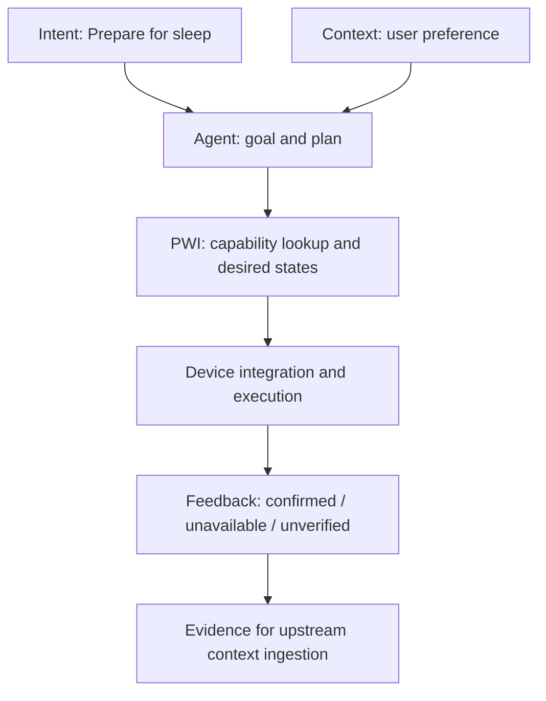

# Module 00 — From User Intent to Physical Outcomes

**Learning path:** PWI Academy — Foundation  
**Prerequisites:** Python 3.10+; no IoT hardware.  
**Status:** This lesson uses an **offline deterministic simulator**. It is NOT a deployed Personal Agent or physical control system.

## Learning objectives

After this lesson, a learner should be able to:

1. Explain the difference between **user intent**, **desired environment state**, and a device-specific command.
2. Identify the responsibilities of the Personal Agent, Personal Context Layer, and Physical World Interface.
3. Explain why a successful command dispatch does not prove an actual physical outcome.
4. Describe how unavailable, unsupported and already-satisfied capabilities should be handled.
5. Run and modify a repeatable test without any home devices.

## System view



The simulator implements a **fixed example plan**, not real intent recognition or device integration. The diagram shows the intended full system boundary.

## Lab 00-A — Discover the planned actions

Clone the repository and run the sample:

```bash
git clone https://github.com/cz-33-ai/physical-world-interface.git
cd physical-world-interface
python3 examples/prepare_for_sleep_simulator.py
```

Identify each mock entity, capability, target and `planned` status.

**Question:** Why does the simulator default to dry-run rather than issuing actions?

## Lab 00-B — Test mock execution and read-back

```bash
python3 examples/prepare_for_sleep_simulator.py --apply
```

Find `verification: "simulated_state_readback"` in the results. It refers to **mock memory state**, not physical devices.

**Question:** What extra evidence would a real light or curtain require before a system could truthfully claim `confirmed`?

## Lab 00-C — Exercise failure and no-op behavior

```bash
python3 examples/prepare_for_sleep_simulator.py --apply --scenario offline
python3 examples/prepare_for_sleep_simulator.py --apply --scenario partially-ready
```

Observe the `unavailable` and `already_satisfied` action statuses.

**Question:** Why is it safer to report a partial outcome than to silently treat every dispatched command as successful?

## Lab 00-D — Change an example user preference

```bash
python3 examples/prepare_for_sleep_simulator.py --temperature 23
```

Find the target AC temperature in the plan. This static CLI parameter is a **stand-in** for a value that a future Personal Agent would obtain through the Personal Context Layer.

**Question:** Which system should own the user's long-term preferred sleep temperature, and which component should execute the climate action?

## Assessment

- [ ] I can explain why physical actuation belongs in PWI but user intent planning belongs to the Agent.
- [ ] I can identify a mock outcome separately from real device feedback.
- [ ] I can explain why unavailable or unsupported devices must be represented explicitly.
- [ ] I can run the tests with `python3 -m unittest discover -s tests -v`.
- [ ] I can change an example preference and explain the resulting plan difference.

## Extension challenges

1. Add a test case for a missing curtain entity and verify it is labeled `unsupported`.
2. Propose an event schema for an action outcome with requested state, observed state, source and timestamp.
3. Sketch how Home Assistant might replace the mock inventory, without exposing its credentials or network details.
4. Outline what should happen if a device reports an old state and its freshness cannot be confirmed.

## Suggested answers (discussion points)

- **Why dry run?** A physical-world system must distinguish a proposed plan from authorized execution.
- **Why read back state?** Network dispatch/acceptance does not prove the environment changed.
- **Why partial failure?** Real environments are heterogeneous and devices can be offline or unsupported.
- **Who owns preference?** The Personal Context Layer; PWI should accept validated action parameters without becoming the canonical long-term memory.

## Next modules

- [Course map](../../docs/course-plan.md)
- [MQTT tutorial](../../docs/01-mqtt-broker-and-lan-test.md)
- [ESP32 + ESPHome tutorial](../../docs/02-esp32c3-esphome-mqtt.md)
- [Zigbee2MQTT tutorial](../../docs/03-zigbee2mqtt-sensor-observations.md)
