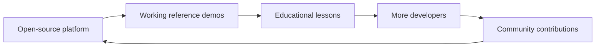

# PWI Open-source Growth and Community Plan

> Strategy only — not a claim that we have external adopters, filmed a hardware demo or launched a course.

## Positioning

**Physical World Interface (PWI)** — an open-source reference for how Personal Agents can perceive the physical world, understand available device capabilities, take authorized actions and verify physical results.

PWI must **complement**, not compete with, mature ecosystems such as Home Assistant, ESPHome and Zigbee2MQTT. Our own contribution should be semantic capability interfaces, truthful execution feedback, Agent integration and reproducible education.

## Three flywheels

1. **Platform:** reusable contracts, minimal adapters and tests.
2. **Demonstrations:** genuinely working device + Agent scenarios with evidence.
3. **Education:** reproducible tutorials and curriculum produced from verified labs.

## Release gates

### Gate A — A stranger can try it

- [x] Public README with clear positioning and limitations.
- [x] Start Here dashboard and open tasks.
- [x] Offline, zero-hardware simulator with tests.
- [ ] Receive feedback from at least one external reproduction ([#9](https://github.com/cz-33-ai/physical-world-interface/issues/9)).
- [ ] Fix unclear steps from that reproduction.

**Distribution:** ask a few developers for honest reproduction feedback; avoid claiming a real physical-world demo.

### Gate B — A physical actuator really responds

- [ ] One actuator connected through the chosen device hub.
- [ ] Video shows actual physical hardware and aligned state feedback ([#10](https://github.com/cz-33-ai/physical-world-interface/issues/10)).
- [ ] Reproducible hardware BOM, configuration, and limitations.
- [ ] At least one documented failure/offline case.
- [ ] Separate mock and real outputs visibly.

**Distribution:** a focused technical write-up for Home Assistant/ESPHome and hardware-maker communities, with links to the tested example. Invite corrections and extensions rather than generic promotion.

### Gate C — The flagship Agent scenario works

- [ ] Actual external Agent issues a semantic task through an authorized interface.
- [ ] Two or more devices support the requested environment outcome.
- [ ] Per-device verification and partial failures work.
- [ ] Video shows intent, plan, physical actions and read-back.
- [ ] Context handoff is documented with provenance and clear limits.
- [ ] Independent setup verification before announcing this as reproducible.

**Distribution:** longer walkthrough, open-source release, developer discussions, conference/community submission, and public course material.

## Reference channels (not automatic posting)

| Audience | Potential venue | What to contribute |
|---|---|---|
| Smart-home builders | Home Assistant Community (Projects / blueprints) | Tested automation or integration and full reproduction steps |
| Hardware developers | Hackster.io; ESPHome community | Actual build, BOM, wiring and code |
| Agent/AI engineers | GitHub, developer blogs, technical communities | Semantic capabilities, MCP/API decisions, execution-result design |
| Chinese-speaking makers | Bilibili, technical articles | Clear hands-on builds and architecture explanations |
| Broader technical audiences | Hacker News, relevant Reddit communities | Useful engineering insight once the result is genuinely substantial |

Follow each community's rules and avoid repetitive cross-posting. Do not advertise an unimplemented Agent system as a working product.

## Content packages we can reuse

For every noteworthy verified milestone, prepare:

1. A **15-word claim** that is both specific and true.
2. A 60–90-second demo storyboard with real footage where hardware is involved.
3. A high-level architecture figure.
4. A self-contained Quick Start with prerequisites.
5. A short article: problem → implementation → verification → limitation.
6. A reproducible repository link, tested version, exact acceptance criteria.
7. One invitation: try it, report a failure, or improve the next capability.

The long-form tutorial should be the source; videos and posts summarize and link back.

## Growth metrics: meaningful before vanity

| Metric | What it measures | How to obtain it |
|---|---|---|
| Time to First Success | How quickly a new developer reproduces an example | Ask external tester to record duration |
| External Reproductions | How many independent setups passed the exercise | Voluntary issue or PR reports |
| Task Success Rate | Percentage of real physical task attempts with verified outcomes | Standard test cases and logs |
| Contributors | Number of distinct helpful external PR/issues | GitHub |
| Course Completion | Learners who complete all acceptance exercises | Opt-in course feedback |

Do not fabricate metrics or imply GitHub Stars equal active adoption.

## Lightweight operating cadence

- **Each completed experiment:** private journal → sanitized public lab note.
- **Each merged feature:** tests, evidence, changelog/README link and issue update.
- **Every 2–4 weeks (when there is actual progress):** one substantive build update.
- **After real demo gates:** community post and reproduction invitation.
- **Quarterly:** decide whether to invest more in platform, demonstrations or education based on user outcomes.

## Immediate growth-oriented issues

- [#6 — Home Assistant initial setup](https://github.com/cz-33-ai/physical-world-interface/issues/6)
- [#3 — Real actuator + state feedback](https://github.com/cz-33-ai/physical-world-interface/issues/3)
- [#4 — Prepare for Sleep](https://github.com/cz-33-ai/physical-world-interface/issues/4)

**Priority:** first real demonstrable physical outcome, then independent reproduction. Publishing posts is not a substitute for working hardware.

## Public progress tracking

- [#9 — Independent zero-hardware Quick Start reproduction](https://github.com/cz-33-ai/physical-world-interface/issues/9)
- [#10 — Film the first verified physical PWI demo](https://github.com/cz-33-ai/physical-world-interface/issues/10)
- [#11 — Validate the first teaching module with external learners](https://github.com/cz-33-ai/physical-world-interface/issues/11)

**Current public evidence:** the Python simulator has six passing local unit tests and GitHub Actions configuration. No claims of independent reproductions, real actuator execution, hardware videos or course completion are made.
