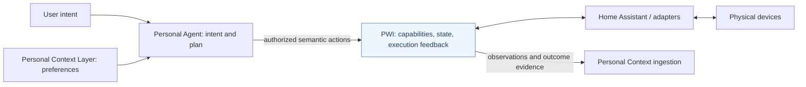

# Flagship Demo Spec — Prepare for Sleep

> **Status:** Design specification. The real connected multi-device demo is **NOT implemented**. A small [offline simulator](../../QUICKSTART.md) is available for the semantic action lifecycle only.

## The 60-second story

A user tells the Personal Agent: **"I'm getting ready for bed."**

The Agent uses relevant preferences and the current room environment to derive the intended physical outcome:

| Capability | Current state (example) | Desired state | What counts as success? |
|---|---|---|---|
| Bedroom main light | On | Off | Reported state is off |
| Curtains | Open | Closed | Cover integration confirms closed position/state |
| Air conditioner | Target 25 °C | Preferred target, e.g. 22 °C | Controller's reported target is updated; actual room temperature takes time |
| Speaker | Playing | Stopped | Player state reports stopped/idle |

These entities are **illustrative**; they are not all presently connected in the lab.

## What an impressive but honest demo shows

### Scene 1 — One natural-language intent (0–10s)
Show the request and the desired environment state. The Agent makes the high-level decision, not PWI.

### Scene 2 — State and capability discovery (10–20s)
Show device capabilities, current state, freshness and availability. Show missing capabilities explicitly instead of inventing devices.

### Scene 3 — Action plan (20–30s)
Show the proposed semantic operations and which devices are already in the desired state. Surface approval/authorization where appropriate.

### Scene 4 — Execution and read-back (30–50s)
Show device commands, accepted/observed states, timeout/failed/unverified outcomes. Avoid claiming success solely because a command was dispatched.

### Scene 5 — Physical result + structured event (50–60s)
Show a camera view of the **actual physical change** alongside action result data. Emit a compact, provenance-aware action outcome for possible context ingestion.

> Never use simulated footage as if it were real hardware. Mark mock footage clearly.

## Logical architecture

## Acceptance criteria for a REAL live demo

- [ ] One natural-language request is interpreted by an actual Agent.
- [ ] At least **two distinct connected actuators** are coordinated by one requested environment goal.
- [ ] Device capability lookup and current-state checks are visible.
- [ ] Every action outcome reports confirmed, failed, unsupported or unverified rather than guessing.
- [ ] At least one failure/offline case is shown accurately.
- [ ] User confirmation and device-access permissions are enforced as appropriate.
- [ ] One observation and one action-result payload are handed toward the Personal Context ingestion boundary (or a documented mock contract).
- [ ] A newcomer can reproduce the demo with a clear BOM, configuration, instructions and privacy-safe examples.
- [ ] The final video displays real hardware separately from diagrams and simulation.

## Staged versions

| Version | Target | Current status |
|---|---|---|
| Demo 0 | Offline Python simulation: semantic plan and mock feedback | **Available; not a hardware demo** |
| Demo 1 | Home Assistant + one connected actuator + verified response | Not started |
| Demo 2 | Two or more actuators coordinated from one intent | Not started |
| Demo 3 | Actual external Agent + Context preferences + structured outcomes | Not started |

## Publishing assets needed for the flagship demo

- Short video (60–90 seconds), plus longer narrated walkthrough.
- Architecture diagram and one clear action lifecycle screenshot.
- Exact equipment list, excluding personal device identifiers.
- Quick Start, optional mock path, real hardware instructions and tests.
- Truthful limitations, security boundaries and version numbers.

**Tracked work:** [#3 — first actuator](https://github.com/cz-33-ai/physical-world-interface/issues/3), [#4 — Agent workflow](https://github.com/cz-33-ai/physical-world-interface/issues/4).
